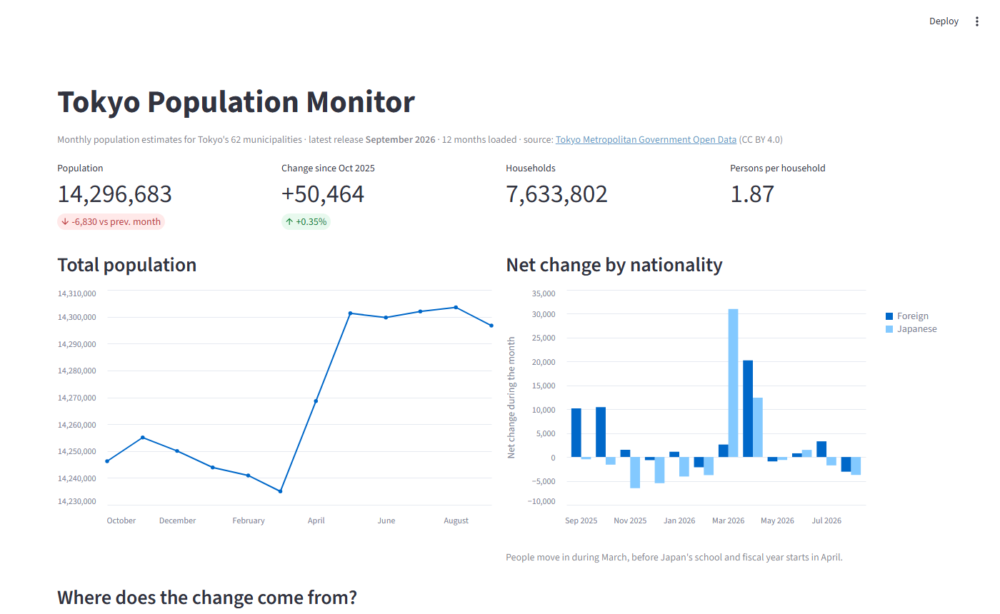
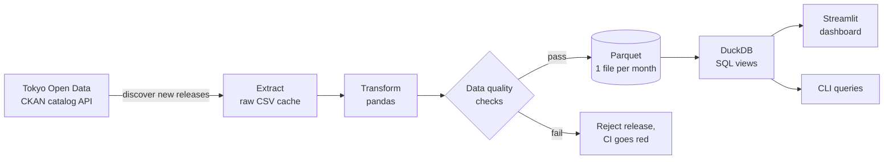

# Tokyo Population Pipeline

[](https://github.com/minami8620/tokyo-population-pipeline/actions/workflows/ci.yml)
[](https://github.com/minami8620/tokyo-population-pipeline/actions/workflows/update.yml)

An automated ETL pipeline that turns the Tokyo Metropolitan Government's monthly
population estimates (東京都の人口（推計）) into clean, validated, analysis-ready
tables, with SQL views and a dashboard on top. It updates itself every week via
GitHub Actions.



## What it does



1. **Discover**: queries the open-data catalog's CKAN API and parses release dates
   from Japanese-era titles (`令和8年9月1日現在` → `2026-09-01`).
2. **Extract**: downloads only releases not yet loaded, with a polite HTTP client
   (identifying User-Agent, rate limit, retries with backoff).
3. **Transform**: the source files are made for humans, not machines. The pipeline
   * drops notes and titles appended below the data rows,
   * removes the 区部 / 市部 subtotal rows that appear twice in every file,
   * normalizes headers whose footnote markers change between releases
     (`面積（ｋm2）注1）` → `area_km2`), full-width characters and trailing spaces,
   * adds English area names and types every column.
4. **Validate**: rejects a release unless the numbers add up (see below).
5. **Load**: writes one Parquet file per table per month. Releases are immutable,
   so re-runs are idempotent and download nothing.
6. **Analyze**: DuckDB SQL views (window functions, `FILTER` aggregates) feed the
   dashboard and the CLI.

## Data quality checks

Every release must pass these before it is loaded:

| Check | Why |
|---|---|
| `population == male + female` for every area | catches column shifts |
| municipalities sum to the prefecture total (population, households, monthly change) | catches truncated or duplicated rows |
| `net = in − out` for each migration flow, `natural = births − deaths` | catches misread columns |
| `net change == sum of components` | internal consistency of the movement table |
| `total == japanese + foreign` for every area and column | catches nationality mix-ups |
| the population table's monthly change == the movement table's net change | cross-table consistency |

**These checks found a real quirk in the source.** The October 2025 release failed
the `total == japanese + foreign` check in 59 areas. A footnote in that file
explains why: it is a census rebasing month, and the total's "other changes"
include a correction from the 2025 census that is not split by nationality. The
pipeline now allows a gap only in that one column, and only when it equals the
gap in net change. The correction is exposed as `census_adjustment` in the
`nationality_trend` view instead of being silently absorbed.

## Findings (12 months of movement data, Sep 2025 – Aug 2026)

* Tokyo has **14,296,683** residents (Sep 2026), **+50,464** since October 2025.
* Among Japanese residents, deaths exceeded births by **47,789**. Net arrivals
  from other prefectures (**+60,355**) more than offset that.
* Foreign residents grew by **43,340**, about 70% of all net growth. Almost all of
  it falls under "other changes" rather than moves from other prefectures.
* Moving season is March: **+30,995** Japanese residents in a single month, just
  before Japan's school and fiscal year starts in April.

## Quick start

```bash
git clone https://github.com/minami8620/tokyo-population-pipeline
cd tokyo-population-pipeline
pip install -e ".[dashboard,dev]"

tokyo-pop update                         # fetch any new releases
tokyo-pop query "from monthly_total"     # SQL against the views
streamlit run app/streamlit_app.py       # dashboard
pytest                                   # 18 tests, no network needed
```

Example query:

```sql
-- Fastest-growing municipalities with at least 100,000 residents
SELECT area_name_en, population, change_since_start, growth_since_start_pct
FROM municipality_latest
WHERE population >= 100000
ORDER BY growth_since_start_pct DESC
LIMIT 5;
```

## SQL views

| View | Contents |
|---|---|
| `population`, `movement` | the cleaned tables (`movement.period` is the month the moves happened) |
| `monthly_total` | prefecture headline numbers per month |
| `municipality_monthly` | per-municipality density, sex ratio, 12-month and since-start growth |
| `municipality_latest` | the latest month, ranked |
| `change_components` | where each area's change came from: other prefectures, within Tokyo, births − deaths, other |
| `nationality_trend` | Japanese vs foreign net change per month, plus the census adjustment |

## Project layout

```
src/tokyo_pop/
  catalog.py     CKAN API discovery
  http.py        polite HTTP session
  wareki.py      Japanese era date parsing
  transform.py   cleaning and typing
  checks.py      data quality checks
  pipeline.py    orchestration
  db.py          DuckDB connection + views
  sql/views.sql  analytical views
app/             Streamlit dashboard
tests/           pytest suite with real source files as fixtures
data/processed/  Parquet output, committed by the scheduled workflow
```

## Automation

`.github/workflows/update.yml` runs every Monday. It makes one catalog search,
downloads only new releases, runs the checks and commits any new Parquet files.
A release that fails validation fails the workflow, so bad data never reaches
`main`.

## Data source and license

Data: [Tokyo Metropolitan Government Open Data Catalog](https://catalog.data.metro.tokyo.lg.jp/),
「東京都の人口（推計）」, Bureau of General Affairs, Tokyo Metropolitan Government,
licensed under [CC BY 4.0](https://creativecommons.org/licenses/by/4.0/).
Processed data in this repository is derived from it.

Code: MIT.
